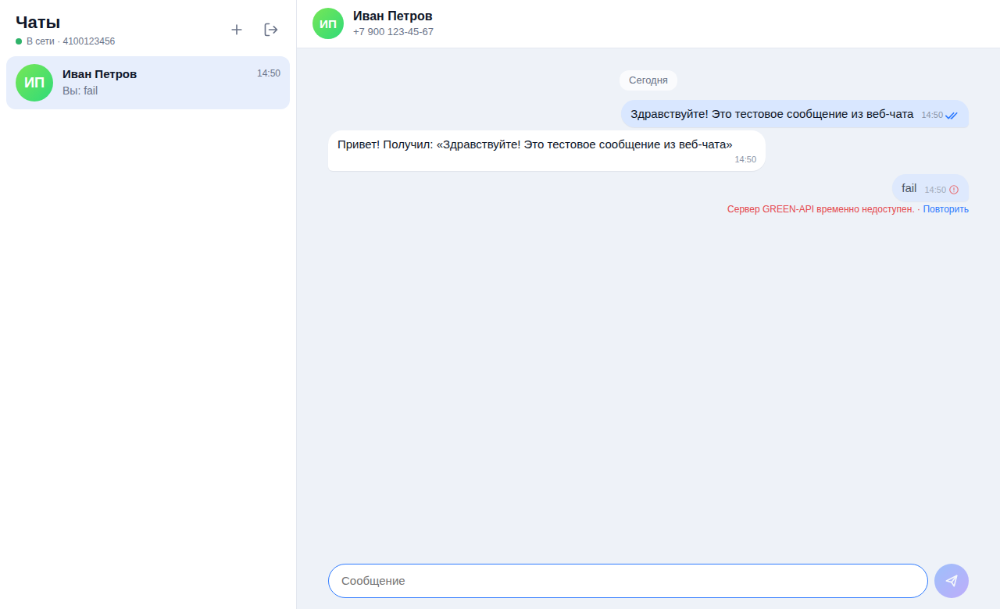

# GREEN-API Telegram Chat

Тестовое задание на позицию «Фронтенд-разработчик React».

Простой веб-чат для отправки и получения **текстовых** сообщений в **Telegram** через [GREEN-API](https://green-api.com/telegram).
Внешний вид основан на веб-версии MAX: список чатов слева, переписка справа.



## Возможности

- Вход по `idInstance` и `apiTokenInstance` (данные проверяются методом `getStateInstance`).
- Создание чата по номеру телефона получателя.
- Отправка текстовых сообщений методом [`SendMessage`](https://green-api.com/telegram/docs/api/sending/SendMessage/).
- Получение сообщений через [HTTP API](https://green-api.com/telegram/docs/api/receiving/technology-http-api/):
  `ReceiveNotification` (long polling) → обработка → `DeleteNotification`.
- Статусы исходящих сообщений: отправляется / отправлено / доставлено / прочитано / ошибка (с кнопкой «Повторить»).
- Сообщения, отправленные с телефона, тоже появляются в чате.
- Входящие от новых собеседников автоматически создают новый чат, есть счётчик непрочитанных.
- История и учётные данные сохраняются в `localStorage`, кнопка «Выйти» удаляет учётные данные.
- Адаптивная вёрстка (мобильная версия) и тёмная тема по системной настройке.

## Стек

React 19, TypeScript, Vite, Vitest. Без UI-библиотек и сторонних state-менеджеров: состояние — `useReducer`, API — `fetch`.

## Локальный запуск

Требуется Node.js 20.19+ (или 22+).

```bash
git clone <ссылка на репозиторий>
cd TestMessenger
npm install
npm run dev
```

Откройте http://localhost:5173.

Другие команды:

```bash
npm test          # unit-тесты (Vitest)
npm run build     # проверка типов + production-сборка в dist/
npm run preview   # просмотр production-сборки
```

## Как проверить

1. Зарегистрируйтесь в [личном кабинете GREEN-API](https://console.green-api.com) и создайте инстанс **Telegram**.
2. Авторизуйте инстанс (QR-код в приложении Telegram: Настройки → Устройства → Подключить устройство).
3. В настройках инстанса включите получение уведомлений о входящих, исходящих сообщениях и статусах.
   Поле **URL для отправки уведомлений (webhook) должно быть пустым** — иначе HTTP API (`ReceiveNotification`) не получит уведомления.
4. Откройте приложение, введите `idInstance`, `apiTokenInstance` и `apiUrl`.
   `apiUrl` подставляется автоматически по первым 4 цифрам `idInstance`; если в кабинете указан другой — скопируйте его оттуда.
5. Нажмите «+», введите номер телефона получателя (например, `+7 900 123-45-67`) и отправьте сообщение.
6. Ответьте из Telegram — ответ появится в чате.

> Telegram присылает ответ от числового `chatId` собеседника, а не от номера телефона.
> Приложение сопоставляет его с чатом по `senderPhoneNumber` и `idMessage` и объединяет в один диалог.

## Структура

```
src/
  api/
    greenApi.ts          # HTTP-клиент GREEN-API: getStateInstance, sendMessage, receive/deleteNotification
    notifications.ts     # разбор уведомлений в события чата
  hooks/
    useNotifications.ts  # цикл long polling с переподключением
  state/
    chatsReducer.ts      # чаты, сообщения, статусы, объединение chatId
  components/            # LoginScreen, Sidebar, NewChatForm, ChatView, MessageList, Composer
  utils/                 # телефон, форматирование, localStorage
```

## Деплой

В репозитории есть workflow GitHub Actions (`.github/workflows/deploy.yml`), который при push в `main`
запускает тесты, собирает проект и публикует его на GitHub Pages.
Нужно один раз включить: **Settings → Pages → Source: GitHub Actions**.

## Ограничения

- Только текстовые сообщения (по условию задания); остальные типы показываются заглушкой.
- История хранится только в браузере: сообщения, полученные до первого входа, не загружаются.
- `apiTokenInstance` хранится в `localStorage` — для тестового задания это допустимо, в production токен лучше держать на бэкенде.
